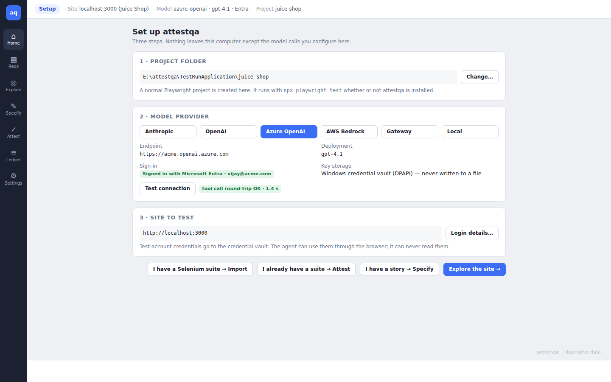
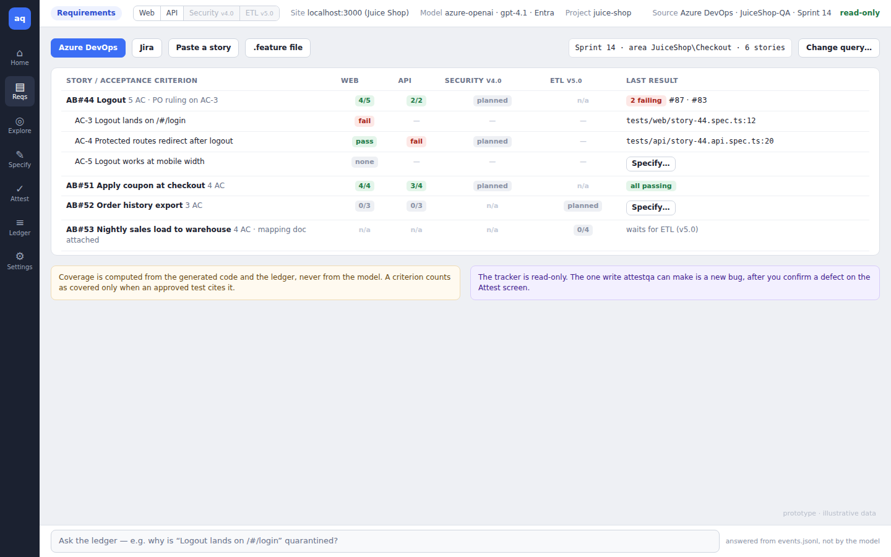
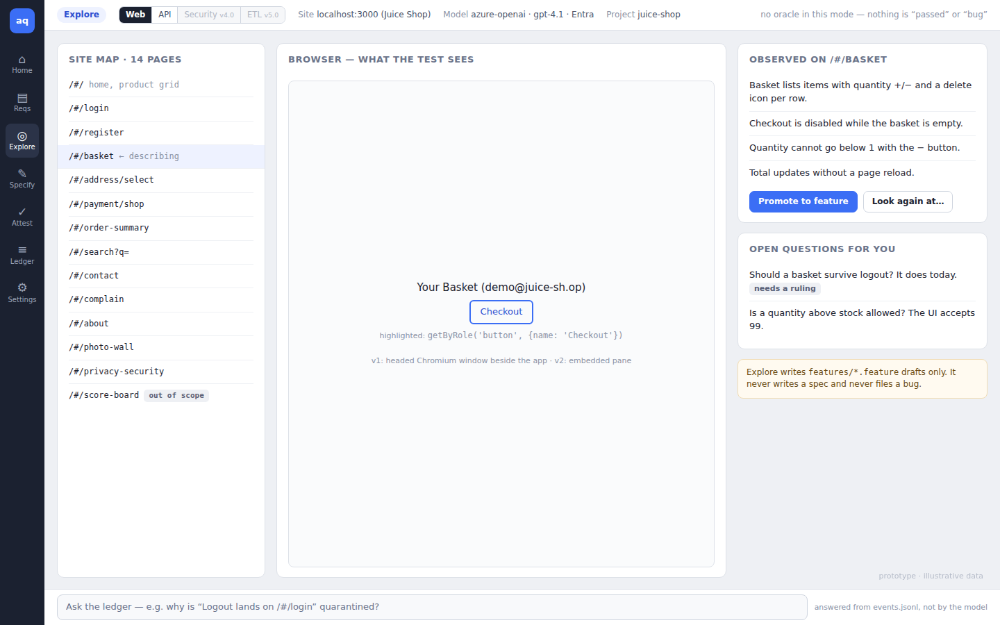
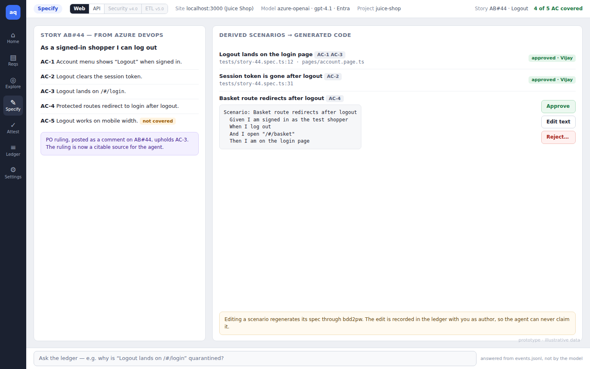
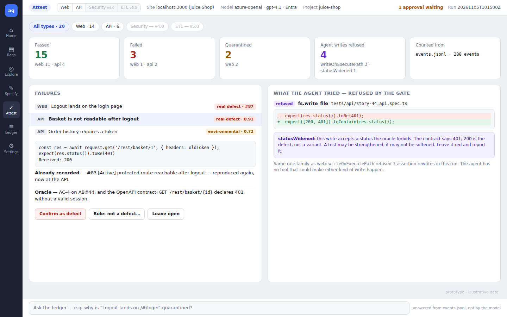
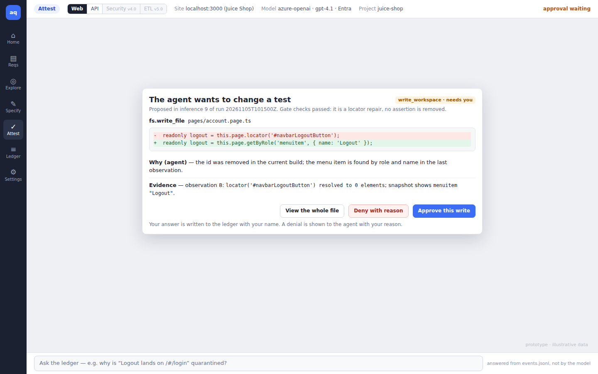

# 1. Purpose

This document fixes how attestqa looks and behaves from the user's side before any UI code is written. The screens below are a static prototype built from HTML. They use real names from the Juice Shop work (story AB#44, the logout defect, rule names from the runtime), but the numbers on them are illustrative and are labelled as such.

# 2. Design principles

**Review, not conversation.** The user's job is to judge what the agent proposes. Every screen is built around a decision the user makes (approve, deny, rule, promote) and the evidence needed to make it. There is no chat box that reaches the model.

**The policy is always on screen.** A strip across the top shows the mode, the site, the model and how the user signed in, the project folder, and anything waiting for the user. Nobody should have to wonder which model is running or what folder it can write to.

**Evidence beside every claim.** A failure shows the assertion and the observation. A refusal shows the diff the agent wanted and the rule that stopped it. A triage verdict shows its confidence and its reason. If the screen states something, the ledger event behind it is one click away.

**The agent's words are labelled as the agent's.** Notes and explanations from the model are marked "agent". Counts and verdicts come from the ledger and are never mixed with the model's prose.

**Nothing on screen is decided by colour alone.** Every status has a text label; the palette passes WCAG AA contrast. The app is itself tested with axe as part of its own suite (AQ-06).

# 3. Navigation

A narrow rail on the left: Home, Requirements, Explore, Specify, Attest, Ledger, Settings. The rail is the mode switch; changing mode changes what the agent is allowed to do, and the policy strip updates to say so.

Next to the mode in the policy strip is the test-type switch: Web, API, Security, ETL. Types not yet released are shown greyed with their release number, so the roadmap is visible in the product itself. Choosing a type changes which adapter and which refusal rules are active, and the strip says which. Requirements and Attest can show all types at once; Explore and Specify always work on one type. The bottom bar is the ledger question box on every screen except first run.

# 4. Screens

## 4.1 First run

Three steps, in the order a security reviewer would want them: where files go, which model and how the user signs in, which site. The provider step tests a real tool-call round trip before letting the user continue, because a provider that answers chat but cannot return tool calls is the most common way a model configuration fails. Credentials typed here go straight to the Windows credential vault; the screen says so in plain words. The last row offers four ways in: explore the site, specify from a story, attest an existing Playwright suite, or import a Selenium suite (converted with sel2pw, then attested).

## 4.2 Requirements

Where a team's own stories come in. The user connects an Azure DevOps or Jira project and picks the work to cover with a sprint, area, saved query or JQL filter; pasting a story or opening a `.feature` file are the fallbacks for teams without a tracker. The grid shows each story, then its acceptance criteria, against the four test types. Each cell is one of: covered and passing, covered and failing, not covered, planned for a later release, or not applicable (a nightly data load has no web test). Counts such as "4/5" mean approved tests cite four of five criteria.

Coverage is computed from the generated code and the ledger. A criterion counts as covered only when an approved test cites it, so the model cannot claim coverage by saying so. From any uncovered cell, "Specify…" opens the Specify screen on that story and type. The strip states that the tracker connection is read-only; the one write attestqa can make is a bug, after a person confirms it on the Attest screen.

## 4.3 Explore

Left: the site map as the agent has built it, with pages the user marked out of scope. Centre: the browser, showing what the test sees, with the element under discussion outlined and its locator printed underneath. In version 1 this is a separate headed Chromium window placed beside the app; version 2 embeds it (see AQ-03 §7). Right: what the agent observed on the current page, written as behaviour, and open questions it cannot answer without a person.

The header says, in words, that this mode has no oracle. The only outputs are draft feature files. "Promote to feature" moves an observation into a draft; "Look again at…" sends the agent back to a page with a bounded instruction, recorded as a call in the ledger. Open questions that the user answers become rulings, the same mechanism as the PO comment on AB#44, and can be cited later in Specify.

The screen shown is web Explore. For API, the centre pane becomes the list of endpoints from the OpenAPI file or from traffic recorded during web exploration, with the selected request and response shown instead of the page. For security it lists the attack surface: routes, forms, cookies and response headers. For ETL it shows source and target tables side by side with their profiles. The left and right columns, and the rule that nothing here is a verdict, stay the same.

## 4.4 Specify

The story on the left, its acceptance criteria numbered, and coverage marked per criterion. Any ruling attached to the story is shown under it. On the right, each scenario the agent derived, which criteria it covers, and the generated file and line. Approved scenarios show who approved them. A pending scenario shows its Gherkin with Approve, Edit text and Reject.

Editing scenario text is allowed and normal. The edit regenerates the spec through bdd2pw and is written to the ledger with the user as author, so the agent can never later present a human's wording as its own, and a later refusal can cite it.

## 4.5 Attest

Tabs across the top filter by test type; the screen shows the state at v2.0.0, with web and API results in one run and security and ETL greyed. Five counts follow, each split by type, the last naming where they were counted from. Below, the list of failures with their type and triage verdict, and the selected failure in full. The example is an API failure: the basket endpoint still answers with a pre-logout token. It is the same defect the web test found as #83, now reproduced one layer down, and the card says so. Each failure card shows the assertion and what was received, the triage verdict with its confidence and reason, whether the defect is already recorded (and its state), and the oracle that makes it a failure. The three actions are deliberately unequal: confirming a defect files a bug with the ledger excerpt as the reproduction; ruling "not a defect" asks for a reason and becomes a citable ruling; leaving it open does nothing.

Beside it, what the agent tried to do about that failure and what stopped it: the diff, the rule name, and the rule's own message. Here the agent tried to accept either 200 or 401, which would turn the defect into a passing test; `statusWidened`, the API counterpart of the web rule `writeOnExecutePath`, refused it. Each test type has its own rules of this kind (AQ-04 §2.6), and they all appear on this card the same way.

## 4.6 Approval

When the gate needs a person, this dialog interrupts whatever screen is open. It names the tool and file, shows the diff, states which gate checks already passed, and gives the agent's reason and the evidence from the ledger separately. "View the whole file" is always available, because a diff without context is how weakening slips through review. Deny requires a reason; that reason is shown to the agent on its next cycle, so a denial teaches the run something instead of just stopping it.

# 5. States that every screen must handle

| State | Behaviour |
|---|---|
| Run in progress | Live counts update; the rail shows a spinner on the active mode; closing the window asks whether to stop the run or keep it running in the tray |
| Model unreachable / token expired | Banner in the policy strip with the provider's own error (scrubbed of secrets) and a "sign in again" action; the run pauses, it does not fail |
| Approval timeout | Nothing is approved by default. After the configured wait the run stops cleanly and the ledger records why |
| Site unreachable | Triage marks the run environmental; the Attest headline says nothing in the run measured the product (behaviour already in the runtime) |
| Empty project | Home suggests Explore and shows the folder that will be created |

# 6. Visual language

System font (Segoe UI on Windows), 13 px base. Neutral grey background, white cards, one blue accent for primary actions. Status colours: green pass, red fail, amber quarantine and waiting, violet for gate refusals — violet is reserved for "the system stopped the agent" so that colour always means the same thing. Monospace (Cascadia Mono / Consolas) for code, paths and locators only. Light theme first; a dark theme follows the Windows setting in a later release.

# 7. What the prototype is not

It is not a pixel specification. Spacing and exact copy will change in implementation. What it fixes, and what sign-off covers, is the set of screens, what each screen lets the user decide, and the rule that no screen offers a conversation with the model.

# 8. Prototype source

The screens are generated by `Docs/prototype/build.py` from HTML and CSS, so they can be revised and re-rendered alongside this document. The same HTML will be the visual reference for the React components in `@attestqa/ui`.
