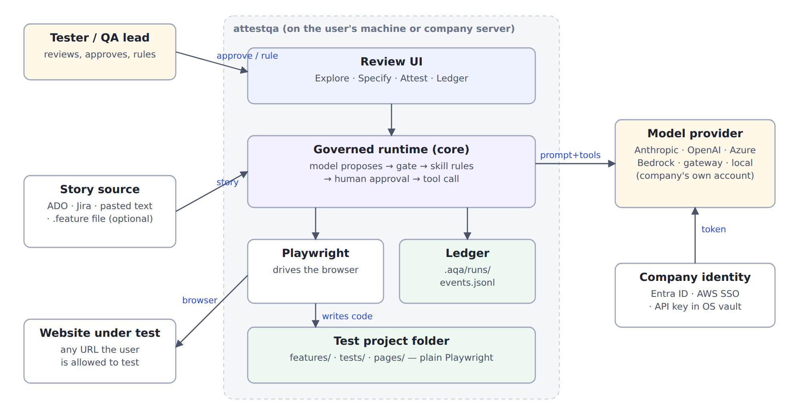
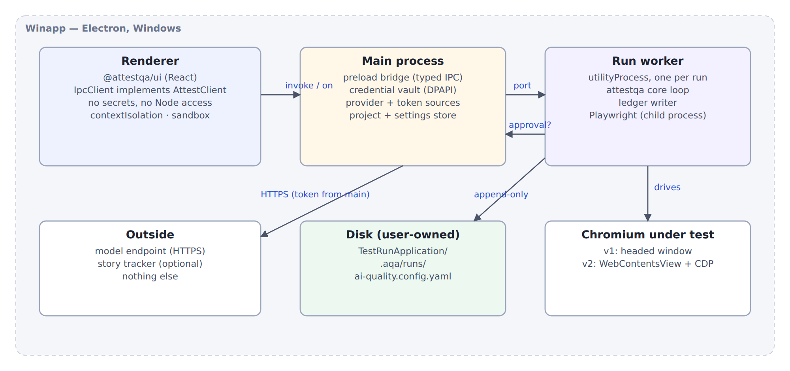
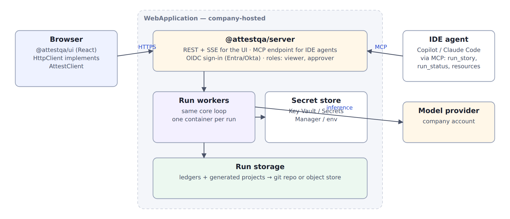
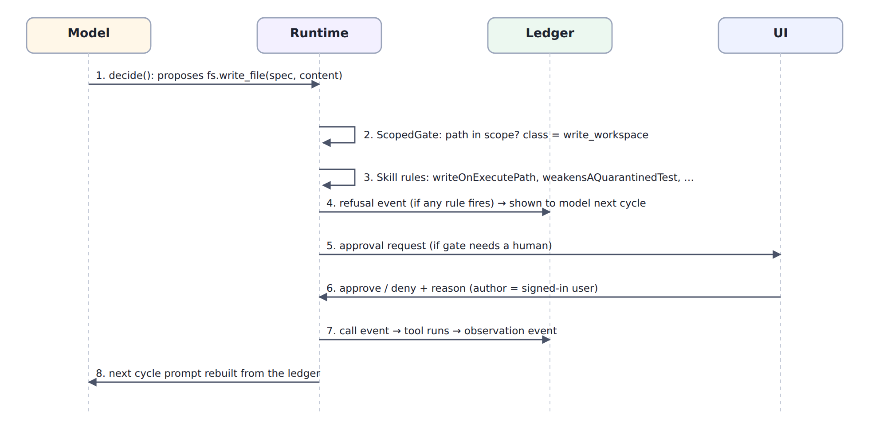

# 1. Scope

This document describes the major parts of attestqa, how they connect, and the technology choices behind them. Interfaces and data formats are in the LLD (AQ-04).

# 2. System context



attestqa sits between four things it does not own: the person reviewing, the story source, the website under test, and the company's model provider and identity system. It owns three things: the governed runtime, the review UI, and the files it writes to disk (the test project and the ledger).

# 3. Repository layout

One git repository at `E:\EB1A_Research\Application\attestqa`, using npm workspaces.

```
attestqa/
  Docs/                  src/*.md, assets/, prototype/, and the signed PDFs
  packages/              shared code, published to npm            (decision D2)
    core/                attestqa runtime + aqa CLI (agentic-qa history via subtree)
    ui/                  @attestqa/ui — React review screens
    client/              AttestClient interface + IpcClient + HttpClient
    provider-bedrock/    @attestqa/provider-bedrock
    auth-azure/          @attestqa/auth-azure  (Entra token source)
    auth-aws/            @attestqa/auth-aws    (AWS SSO token source)
    tracker-jira/        @attestqa/tracker-jira (Jira; ADO stays in core via Microsoft's MCP server)
    adapter-zap/         @attestqa/adapter-zap  (security scanning, v4.0)
    adapter-sql/         @attestqa/adapter-sql  (read-only database access, v5.0)
  Winapp/                Electron shell: main, preload, worker host, installer config
  WebApplication/        @attestqa/server (REST + SSE + MCP) and its container files
  TestRunApplication/    one Playwright project per site under test + targets.yaml
  research/              findings log, decisions, hypotheses, run manifest  (AQ-08)
```

The four folders you named are kept exactly. Two are added, `packages/` and `research/`, because shared code should not live inside either app, and research records should not live inside the code. Both additions are listed for approval in AQ-00.

The agentic-qa repository in `Paper_I_AgenticQA/Experiment/agentic-qa` is not moved or edited. It is the artefact Paper I cites. Its history is brought into `packages/core` with `git subtree`, so every commit hash quoted in the paper still resolves inside the new repository (AQ-07).

# 4. Major components

| Component | Responsibility | Runs in |
|---|---|---|
| core (`attestqa`) | The governed loop: model client, ScopedGate, skill refusal chain, approvals, tool adapters (fs, pw, heal, api, ADO tracker), ledger, triage, report | Worker process (desktop) or worker container (web); also the CLI |
| providers | Turn `agent.model` config into a model client; one conformance suite for all | Inside core; Bedrock as a plug-in |
| auth plug-ins | Supply short-lived tokens (Entra, AWS SSO) instead of stored keys | Main process (desktop) or server (web) |
| ui (`@attestqa/ui`) | The six screens in AQ-02; talks only to an `AttestClient` | Electron renderer, or any browser |
| client | One TypeScript interface, two implementations: over Electron IPC, over HTTP + SSE | Renderer / browser |
| Winapp | Window, tray, credential vault, settings, starting and stopping workers, installer, auto-update | Electron main process |
| server | Users, roles, run queue, workers, REST + SSE for the UI, MCP for IDE agents | Node service in a container |
| skills | story-to-tests (exists), heal (exists), explore (new, oracle-less); each made type-aware (web, api, security, etl) | Inside core |
| tracker adapters | Read stories, criteria, comments and linked bugs; create a bug after human confirmation. ADO in core, Jira as a plug-in | Worker |
| our packages | `bdd2pw` and `pw-emit` (code generation), `synthdata` (test data), `pw-self-heal` (locator suggestions), `sel2pw` (Selenium import), `usagecontract` (API contracts from traffic); see §13 | Worker, as npm dependencies |
| test-type adapters | `api` (Playwright request context + OpenAPI validation), `zap` (passive and active scanning), `sql` (read-only queries) | Worker; ZAP as a local daemon the worker starts |

The key structural decision is that the UI never imports core. It sees an `AttestClient`. That one seam is what lets the same React code run in the desktop app and in a browser.

# 5. Test types on one engine

The mode (Explore, Specify, Attest) and the test type (web, API, security, ETL) are independent settings. Everything that makes a result trustworthy is shared across types: the gate, the refusal chain, approvals, the ledger, triage and the counted report. Each type adds three things, and only these three.

| Type | Release | Adapter | Oracle source | Type-specific refusal rules | Hard capability limit |
|---|---|---|---|---|---|
| Web | v1.0–v1.4 | `pw` (exists) | Story acceptance criteria | existing chain (`writeOnExecutePath`, `weakensAQuarantinedTest`, `swallowedFailure`, …) | URLs in scope |
| API | v2.0–v2.1 | `api`: Playwright `APIRequestContext`, OpenAPI schema validation | Criteria + OpenAPI contract in `contracts/` | `statusWidened`, `schemaCheckDropped`, `expectedFieldRemoved` | Hosts in scope only |
| Security | v4.0–v4.1 | `pw` for passive checks; `zap` for scanning | Criteria + chosen OWASP ASVS requirements | `findingSuppressed`, `allowListGrown`, `severityLowered` | Active scan is `destructive` class; offered only when the target has a recorded written authorisation |
| ETL | v5.0 | `sql`: read-only client (PostgreSQL, SQL Server, SQLite first) | Source-to-target mapping in `contracts/` | `toleranceWidened`, `rowFilterAdded`, `expectedSetToActual` | Adapter parses every statement and rejects anything but a read; credentials must be read-only |

All four types write `@playwright/test` files and run through the same runner (decision D16). That keeps one report format, one triage path and one way to run the suite without attestqa. Security scanning is the one place a second tool is involved; ZAP's findings are converted into test results by the adapter, so they appear in the same report.

API comes second because it reuses the most: the same runner, the same projects, and traffic already recorded while exploring the web interface. It also extends the weakening study to a second layer quickly (AQ-08, H5).

# 6. Requirements sources

Azure DevOps (in core today, through Microsoft's `@azure-devops/mcp` server) and Jira (`@attestqa/tracker-jira`, v1.0.0) implement one tracker interface (AQ-04 §2.7). The user selects work by sprint, area, saved query or JQL. The worker reads stories, acceptance criteria, comments and linked bugs into `context` events, so every criterion the agent tests against is in the ledger with its source. Coverage on the Requirements screen is computed by matching approved tests' criterion tags against the stories, never by asking the model. Tracker access is read-only except bug creation after human confirmation. Without a tracker, pasted text and `.feature` files take the same path.

# 7. Desktop architecture (Winapp)



Three kinds of process, kept apart on purpose:

**Renderer.** Draws the UI. Runs with context isolation, sandboxing and no Node integration. It never sees a credential, a raw model request, or a file path outside the project.

**Main.** The only trusted process. It holds the credential vault, builds the model client, owns settings and the list of projects, and starts workers. It exposes a small, typed set of IPC calls through the preload script and nothing else.

**Run worker.** One Electron `utilityProcess` per run. It hosts the core loop, writes the ledger, and launches Playwright as its own child process. A crash in Playwright cannot take down the ledger writer's parent, and a 40-minute run cannot freeze the window. Approval requests travel worker → main → renderer and back over a `MessagePort`.

**Browser under test.** Version 1 uses Playwright's own headed Chromium, positioned beside the app. That has no integration risk and the user sees exactly what the test sees. Version 2 embeds the page in a `WebContentsView` and connects Playwright over CDP so Explore can outline the element it is describing. v2 is a feature, not a prerequisite for 0.1.0.

**Credentials.** Encrypted at rest with Electron's `safeStorage`, which uses Windows DPAPI tied to the user's login. Entra and AWS SSO tokens are never stored long-term; the plug-ins refresh them. Nothing secret is written to the project folder, the ledger, or logs. The existing scrubber in core runs on every outgoing model request regardless.

**Packaging.** electron-builder producing an NSIS installer, signed (Azure Trusted Signing or an OV certificate, decision D6), with electron-updater reading GitHub Releases. Node and Playwright's Chromium are bundled; first run installs `@playwright/test` into the project so the suite runs without the app.

# 8. Web architecture (WebApplication)



The server is a Node service that does three jobs: it serves the UI and its API (REST for actions, server-sent events for live run updates), it runs workers (one container per run, using the same core), and it exposes an MCP endpoint so IDE agents can start a run and read its result. Users sign in through the company's OIDC provider. Two roles matter: viewer and approver. Approvals are made by a named user and recorded as such.

The MCP surface follows the 2026-07-28 specification direction described in `RESEARCH_mcp_2026-10-07.md`: `run_story` returns a handle immediately, `run_status` reports progress, finished runs are resources at `aqa://runs/<id>`, and there is deliberately no `approve()` tool. An IDE agent can start work and read results; it cannot approve its own proposals.

Model credentials live in the company's secret store (Key Vault, AWS Secrets Manager, or environment). Ledgers and generated projects go to a git repository or object store the company controls. We never operate a hosted instance.

# 9. One governed step



This sequence is unchanged from the current runtime and is the same in desktop and web. The model proposes a call. The ScopedGate checks scope and classifies it (read, write_workspace, write_branch, write_record, destructive). The skill's refusal chain runs. A refusal is written to the ledger and shown to the model on its next cycle. If the class needs a person, the approval request goes to the UI and the answer, with the user's name, goes to the ledger. Only then does the tool run, and its observation is recorded. The next prompt is rebuilt from the ledger; no provider keeps conversation state.

# 10. Technology choices

| Area | Choice | Why | Alternatives considered |
|---|---|---|---|
| Language | TypeScript throughout | Core is already TypeScript; one language for desktop, web and engine | — |
| Desktop shell | Electron | Node runtime already hosts core; bundles Chromium; proven by Cypress's desktop runner | Tauri (Rust host, would need core in a sidecar), WinUI (no shared UI with web) |
| UI | React 18 + Vite | Shared by desktop and web (agreed); largest component ecosystem | Svelte, Vue |
| UI state | TanStack Query over `AttestClient`; small local store for UI-only state | Server state and UI state kept apart; same code over IPC or HTTP | Redux |
| Test runner driven | Playwright | Existing adapters, bdd2pw output, trace viewer | Selenium (sel2pw converts existing suites in) |
| Code generation | `pw-emit`, extended with API, security and ETL emitters | Our own published emitter; one shape for all generated code | Templates inside core |
| Web server | Node, Fastify | Same runtime as core; schema-validated routes | Express, NestJS |
| MCP | Official TypeScript SDK | Tracks the spec | Hand-rolled |
| Credential storage (desktop) | Electron `safeStorage` (DPAPI) | Built in, no native module to maintain | keytar (archived), OS credential manager bindings (decision D5 if Credential Manager is required by name) |
| Packaging | electron-builder, NSIS | Signing and auto-update built in | Squirrel, MSIX |
| API testing | Playwright `APIRequestContext` + an OpenAPI validator (Ajv) | Same runner and report as web; no second framework | REST Assured, Postman/Newman |
| Security scanning | OWASP ZAP in daemon mode, driven by its API | Open source, scriptable, standard in CI | Burp Suite (commercial), Nuclei |
| ETL access | Node database drivers behind one read-only adapter | Runs inside the same test runner | Great Expectations, dbt tests (Python; a second runtime) |

# 11. Non-functional requirements

| Requirement | Target |
|---|---|
| Ledger integrity | Append-only JSONL; every report number reproducible from the ledger by a script with no model access |
| Privacy | No telemetry by default. Nothing leaves the machine except calls to the configured model endpoint and optional tracker |
| Responsiveness | UI never blocks on a run; approval dialog appears within 1 s of the worker asking |
| Startup | App window in under 3 s on a typical company laptop |
| Crash safety | A worker crash leaves a readable ledger ending in a `run.aborted` event written by main |
| Accessibility | Own UI passes axe with no serious or critical violations |
| Supportability | Every error a user can see names what to do next |
| Provider parity | All providers pass the same conformance suite before release |

# 12. Main risks

| Risk | Effect | Mitigation |
|---|---|---|
| Unsigned installer blocked by SmartScreen / company policy | No adoption in companies | Treat signing as release-blocking (D6) |
| Smaller or local models handle tool calls poorly | Runs stall | Conformance suite includes a tool-call round trip; first run tests it; refusals already say how to clear themselves |
| Explore produces noise | Users lose trust early | Explore output is drafts only; promotion is a human act |
| Testing hosted practice sites goes beyond what owners allow | Ethical and legal exposure | Target registry with permission basis and rules of engagement (AQ-06) |
| Scope creep from the web version delaying desktop | No release | The web version starts only after desktop web and API testing have shipped (v1.4, v2.1) (AQ-05) |
| Changing the runtime invalidates Paper I evidence | Paper weakened | Corpus tag frozen; new studies tag their own runtime commit (AQ-08) |
| Active scanning reaches a site without permission | Legal exposure | Scanning is `destructive` class and only offered when `targets.yaml` records written authorisation; local Juice Shop only on our side |
| ETL adapter used to change data | Data loss in a customer warehouse | Statement parser accepts reads only; the docs require read-only credentials; both checked by tests |
| Four test types spread the work too thin | No type done well | One type per release; each release has its own exit criteria (AQ-05) |

# 13. Our own packages inside attestqa

attestqa depends on six packages already published under `@vijaypjavvadi`. They are ordinary npm dependencies with pinned major versions; none of their code is copied into core.

| Package | Called from | Contract with attestqa | Governance point |
|---|---|---|---|
| `bdd2pw` | Specify (web) | Approved `.feature` in, page objects and specs out | Output is a proposed write; the gate judges it like any other |
| `pw-emit` | Specify (all types), via bdd2pw for web | Generic test IR in, Playwright files out; new IR node kinds for API requests, security checks and SQL reconciliations | Same as above; emitted tests carry `@story`, `@ac`, `@kind` tags for coverage |
| `synthdata` | All modes, as the `synthdata.generate` tool | Schema + plan in, data file or database out, written inside the workspace | Read-only towards anything outside the workspace; the plan is stored with the run |
| `pw-self-heal` | Heal role | DOM snapshot + failing locator in, ranked candidates out | Suggestion only. Its run-time self-healing mode is disabled in governed runs; a chosen candidate becomes an `fs.write_file` that must pass `writeOnExecutePath` and approval |
| `sel2pw` | First run, "I have a Selenium suite" | Selenium project in, Playwright project out | The converted suite is the oracle for Attest from then on; the conversion report is recorded as a `context` event |
| `usagecontract` | API Explore and Specify (v2.1) | Recorded traffic in, per-consumer contract out | The derived contract is shown for approval before it can serve as an oracle |

`pw-triage` shares attestqa's failure classes and event envelope. Its classifier and core triage are kept in step by a shared fixture set, so the same failure gets the same verdict from either tool.
